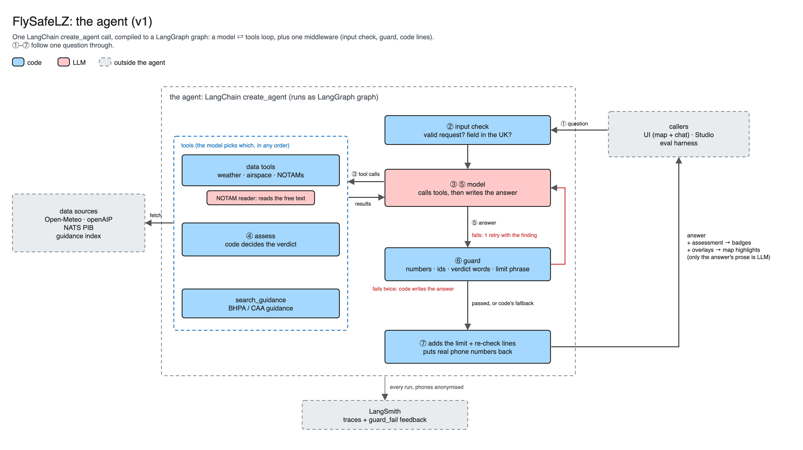

# FlySafeLZ

**Some context on why this was chosen first:** Below is me landing my 7th paramotor flight last Saturday (30th October), just moments before a man in orange high-viz ran onto the field waving his arms and signalling for us to pack up. He was from a drone company surveying for methane over the North Sea and they had a “NOTAM” over the field. It had appeared on Gaggle (flight recorder app for paramotor pilots), and yet none of us really knew what it meant.

Since learning to fly this July, the question of safety has been top of mind. Paramotoring follows as extreme “low risk, high consequence” risk profile. Hence, systematic checking and rigour are literally life saving. On the other hand, as an unregulated sport, anyone can strap a motor to their back and take to the skies. 

**FlySafeLZ bridges this exact gap**: a map and chat agent for UK paramotor pilots. You click a landing zone (LZ), ask "can I fly here this afternoon?", it checks the forecast, the permanent airspace and the live NOTAMs, then tells you if anything rules the flight out and surfaces important considerations pilots should make. Handing trustworthy advice to the pilot in this context requires a series of deterministic and non-deterministic checks, which are explained below. You’ll find more information on the NOTAM in particular, given its reputation in aviation as a particularly messy and noisy data source, often tripping pilots up. 

**Stack:** LangChain v1 (`create_agent`, one middleware for the guard) · LangGraph (the runtime: thread memory, the server behind Studio and the UI, streaming) · LangSmith (traces, datasets, experiments, the annotation queue that calibrates the judge) · Python 3.12 with uv · local embeddings (fastembed) for the guidance search · React, Vite and Leaflet for the map. Models: Claude Sonnet 5.5 (agent), Haiku 5.5 (NOTAM reader), Opus 5.5 (judge).

**On project size:** The agent and the evals are deliberately small: one `create_agent` call with five tools and one middleware, and a 44-example dataset. The repo is bigger because I also built around them, the deterministic core, the map UI etc. I did that because I’d like to deploy FlySafeLZ and test it in my local paramotor club, so I built it to be used as opposed to just reviewed.

## TL;DR

- **The problem.** Before a flight a paramotor pilot checks wind, weather, daylight, airspace and NOTAMs. Everything but the NOTAMs is a number against a limit or a shape on a map, so code checks it. NOTAMs are free text, and most of what a pilot scrolls past doesn't apply to their field, so the real failure is alert fatigue: **precision is a safety metric**. [More](https://github.com/danrfletcher/flysafelz/blob/main/problem.md)
- **What it does.** You click a field and ask a question. Code gives one verdict per time segment: NO-GO, UNVERIFIED, PILOT DISCRETION – APPROACHING LIMITS, PILOT DISCRETION – WITH CONDITIONS or PILOT DISCRETION. There's no "GO": it only decides when *not* to fly. [More](https://github.com/danrfletcher/flysafelz/blob/main/problem.md#what-the-agent-does-and-doesnt-do)
- **The design.** One `create_agent` call, five tools, one middleware. Code sets every verdict from the limits in [`rules.yaml`](https://github.com/danrfletcher/flysafelz/blob/main/src/flysafelz/rules.yaml). The model has two jobs: a small model reads each NOTAM's free text into fixed fields (code turns those into an action), and the agent picks the tools and writes the answer. A guard checks every number, NOTAM ID, phone number and verdict word against the tool results before the pilot sees it. [More](https://github.com/danrfletcher/flysafelz/blob/main/how-it-works.md)
- **How I know it's good.** 44 hand-written examples from real days (29 dev, 15 held-out), scored safety first: missed blockers, then verdicts minute by minute, NOTAM actions, noise, tool calls and the guard. An LLM judge scores only what needs judgement, calibrated against 39 answers I labelled. [More](https://github.com/danrfletcher/flysafelz/blob/main/evals.md)
- **Results.** A single model call given the same data (v0) still leads on held-out: on the rules step a model is about as good as code. What code buys is guarantees: the same answer every time, tested, and a guard that can hold the model to it. v2 fixed the worst failure v1 showed (a NOTAM with no floor crashed the assessment; a one-line fix): verdict match went from 51.5% to 89.0% on dev and from 42.9% to 71.4% on held-out. [More](https://github.com/danrfletcher/flysafelz/blob/main/results.md)
- **Where it struggles.** I read every trace flagged as a missed blocker: 27 flagged, 16 real, from two failures. A vague time ("later tonight") gets a question back instead of an assessment, and a phone-first NOTAM is read as awareness. In none of them was the pilot told to fly. [More](https://github.com/danrfletcher/flysafelz/blob/main/where-it-struggles.md)
- **What's next.** Fix those two, round coordinates in traces, and have instructors check the limits. [Known gaps](https://github.com/danrfletcher/flysafelz/blob/main/where-it-struggles.md#known-gaps-and-tradeoffs) · [Evaluating it in production](https://github.com/danrfletcher/flysafelz/blob/main/production.md)

## Where to look first
10-min rocketship tour:

1. **The agent:** `src/flysafelz/agent/graph.py` (99 lines). One `create_agent` call, five tools, one middleware.
2. **The verdict:** `src/flysafelz/assess.py`. Code decides every verdict; the model never does.
3. **The guard:** `src/flysafelz/agent/guard.py`. Checks the model's answer against the tool results before the pilot sees it.
4. **The evals:** `evals/agent/` (dataset, evaluators, judge) and the results in `evals/results/`.
5. **The traces:** every experiment, public: [dev](https://eu.smith.langchain.com/public/217f1dfa-eca7-4da3-ba3f-b417a5bb8c71/d), [held-out](https://eu.smith.langchain.com/public/df5d87b1-f698-4fb8-b038-930e5450b565/d). One full v2 trace: [Blue Mill, Cobra Warrior day](https://eu.smith.langchain.com/public/8e70514b-91ad-4aee-b943-ea9c10a7e518/t). The harness names agent runs `v1-…` by agent type, so v2 is the later `v1-` experiment on each split (dev `…-122845`, held-out `…-130704`).

To run it, see [Running it](https://github.com/danrfletcher/flysafelz/blob/main/running-it.md) or the [README](https://github.com/danrfletcher/flysafelz#quickstart).
